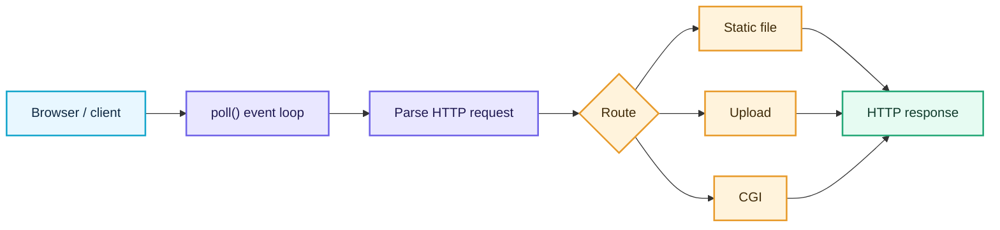

<p align="center">
  
</p>

<h1 align="center">⚡ Webserv</h1>
<p align="center"><strong>From socket to response.</strong><br />A lightweight HTTP/1.1 server in C++98, built as a 42 team project.</p>

<p align="center">
  
  
  
  
</p>

---

## 🌐 What is Webserv?

Webserv is an educational systems-programming project about the machinery behind a web request: accepting a connection, parsing HTTP, choosing a route, and sending the right response. The implementation uses low-level networking and a non-blocking event loop.

> This is a personal fork of the original team repository. The original project and commit history are preserved: [LeenAlmahthi/webserv-](https://github.com/LeenAlmahthi/webserv-).

## 🔄 Request flow



## ✨ Project scope

| Area | What it covers |
| --- | --- |
| ⚡ **Networking** | Non-blocking client/server sockets managed with `poll()` |
| 🧭 **Routing** | Multiple server configurations, listening ports, methods, and redirects |
| 📄 **Static content** | Files, index pages, and directory listings |
| 📤 **Uploads** | File upload handling and request-body limits |
| 🧩 **CGI** | Script execution configured by file extension |
| 🛠️ **HTTP details** | Error pages and chunked request-body decoding |

## 🚀 Build and run

```bash
make
./webserv configs/webserv.conf
```

The example configuration listens on `127.0.0.1:8080` and demonstrates static files, CGI, uploads, and redirects. A second example is available at `configs/test.config`.

## 🧪 Try it

Start the server in one terminal, then try:

```bash
curl -i http://127.0.0.1:8080/
python3 tests/raw_requests.py
bash tests/stress_static.sh
```

The repository also includes CGI and upload test scripts. Make sure the configured interpreter paths and test prerequisites exist on your machine before running them.

## 🤝 Team

Built with **[Narjes Almasri](https://github.com/Narjes-almasri)**, **[Leen](https://github.com/LeenAlmahthi)**, and **[Sara Kteifan](https://github.com/SaraKteifan)**. This fork keeps the team project's original history and attribution.

## 📌 Project note

This is a 42 coursework project, not a production web server. The features above describe project scope; validate behavior against your campus subject and evaluation tests before presenting it as fully compliant.
